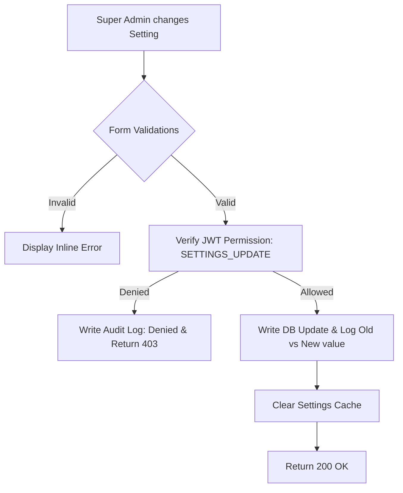
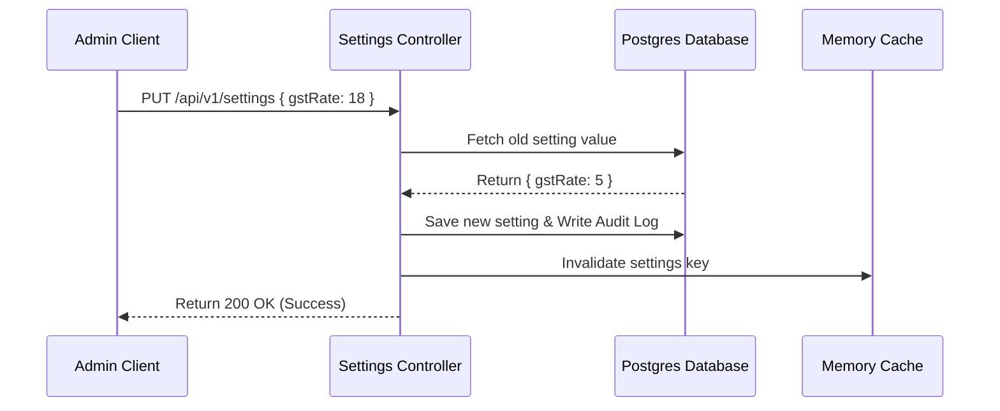
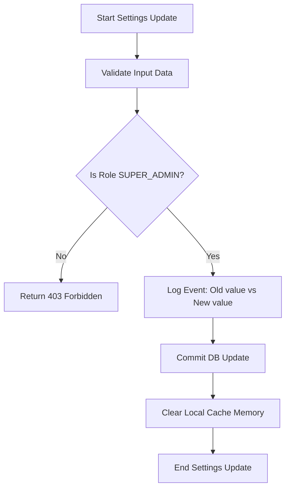

# Module 3 Design Document: Restaurant Settings & Configuration

This document specifies the architecture, database representation, endpoints, and interface specs for the **Restaurant Settings & Configuration** dashboard.

---

## 1. Module Overview
The Restaurant Settings & Configuration module serves as the central administrative registry of the Restaurant POS. Every other system module (billing totals, invoice generation, ticket printing formats, payment networks, and theme assets) queries this config store to dynamically adapt its behavior. 

---

## 2. Business Objectives
- **Centralized Administration**: Enable administrative managers to configure VAT/GST tax rates, billing schemas, token counters, and printer routes.
- **Future Scale**: Support multi-branch configurations where settings can be declared locally per workstation terminal.
- **Strict Compliance**: Audit and logs settings changes to prevent unauthorized modifications.

---

## 3. Functional Requirements
- **Administrative Lock**: Settings endpoints are restricted to `SUPER_ADMIN` roles only.
- **Settings Exporter/Importer**: Backup settings in encrypted configurations (JSON format).
- **Branding Assets**: Upload custom branding logos.
- **Drawer and Printer mapping links**: Assign physical device paths to workstations.

---

## 4. Non-Functional Requirements
- **High Availability**: Configurations must be cached locally to prevent database lookups on every invoice printing request.
- **Auditing Integrity**: Every update must trigger an `AuditLog` mapping old values to new values.

---

## 5. User Stories
- *As a Super Admin, I want to edit our GST rate so that billing calculations reflect current government policies.*
- *As a Cashier, I want to view printer paper width configurations without having permissions to modify them.*

---

## 6. Use Cases
### Use Case: Update Tax Settings
1. Super Admin navigates to Settings -> GST & Tax.
2. Changes Default GST % from 5% to 18%.
3. Clicks "Save". System validates GST format.
4. System updates database, writes to Audit logs, and flushes configuration cache.

---

## 7. Workflows


---

## 8. Business Rules
- Only **one** Business Day can remain active in the system.
- Packed menu items must never trigger a Kitchen Order Ticket (KOT).
- The UPI Payment channel can only be toggled active if a valid UPI ID is saved.

---

## 9. Validation Rules
- **Restaurant Name**: Required, length 3 to 100 characters.
- **GST Number**: Matches standard format.
- **Logo Size**: Max 2MB (PNG/JPG only).
- **Timezone**: Must be a valid IANA time zone (e.g. `Asia/Kolkata`).

---

## 10. Database Design

### Single-Table vs Multi-Table Approach
- **Recommendation**: Single-Table (Key-Value Schema).
  - *Rationale*: Settings keys fluctuate as features grow. Rather than running database migrations for every new configuration toggle (e.g. `enableUpi`, `backupFrequency`), storing settings as a dynamic JSON object or a series of Key-Value records in a `RestaurantSettings` table maximizes flexibility and facilitates quick settings imports/exports.

```prisma
model RestaurantSetting {
  key         String   @id @db.VarChar(100)
  value       String   @db.Text
  group       String   @db.VarChar(50) // BILLING, TAX, PRINTER, BRANDING
  updatedBy   String?  @db.Uuid
  updatedAt   DateTime @updatedAt

  @@map("restaurant_settings")
}
```

---

## 11. API Specifications

### GET `/api/v1/settings`
- *Access*: Authenticated cashiers and admins.
- *Response*: Returns all settings parsed as a key-value JSON map.

### PUT `/api/v1/settings`
- *Access*: `SUPER_ADMIN` only.
- *Body*: Mapped object containing changes.
- *Response*: Status 200 OK.

---

## 12. UI Wireframe Description
The configuration panel is structured around a tabbed dashboard inspired by Stripe:
- **Left Column**: Navigation tabs (`Branding`, `GST & Tax`, `Printers`, `Backups`).
- **Main Drawer Pane**: Form inputs mapped to current tab state.
- **Bottom Status Ribbon**: A sticky "Unsaved Changes detected" banner with "Save Changes" and "Reset" actions.

---

## 13. Components Required
- `SettingsTabs`: Side navigation items.
- `GSTForm`: GST/VAT tax slab forms.
- `BrandingForm`: Primary/Secondary color inputs and logo upload triggers.

---

## 14. Backend Services
- `SettingsService`: Cache wrapper utilizing memory stores, querying DB only on cache misses.

---

## 15. Folder Structure
- `backend/src/modules/settings/`
  - `controllers/settings.controller.ts`
  - `services/settings.service.ts`
  - `routes/settings.routes.ts`
- `frontend/src/pages/settings/`
  - `SettingsDashboard.tsx`

---

## 16. Mermaid Sequence Diagram


---

## 17. Mermaid Workflow Diagram


---

## 18. Acceptance Criteria
- Verify that changes are rejected with 403 Forbidden if executed by a `CASHIER` account.
- Verify that old setting values are preserved inside `audit_logs` records upon update.

---

## 19. Future Enhancements
- **Multi-Branch Configurations**: Add a `branchId` column to settings table to scope configurations.
