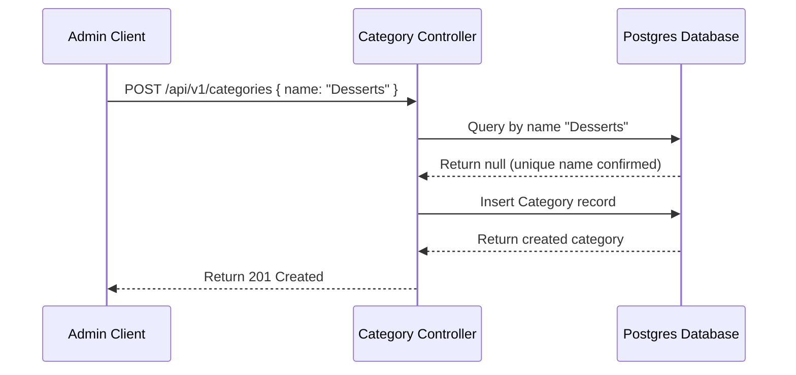
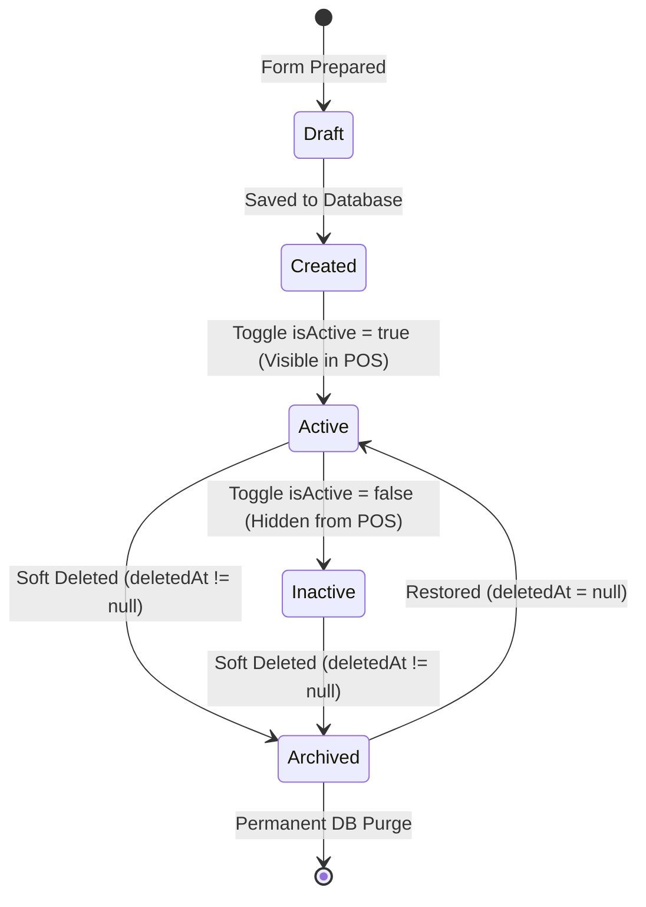
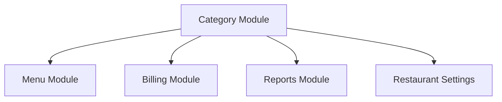

# Module 4 Design Document: Category Management

This document specifies the architecture, database adjustments, endpoints, and interface specs for the **Category Management** module.

---

## 1. Module Overview
The Category Management module allows administrators to classify, filter, and prioritize items (e.g. South Indian, Beverages, Desserts). These categories enable cashier search efficiency at checkout terminals and support sales analytics segmentation.

---

## 2. Business Objectives
- **Optimized Checkout Speeds**: Group items logically to decrease cashier navigation click-times.
- **Reporting Segmentation**: Categorize items to feed category sales reports (e.g., tracking kitchen vs. packed sales metrics).

---

## 3. Functional Requirements
- **Category CRUD**: Full Category creation, reading, updating, and soft deleting.
- **Visibility Toggles**: Toggle active statuses (`isActive` flag).
- **Sort Priority**: Change visual arrangement using `displayOrder` fields.

---

## 4. Business Rules
- **Unique Names**: Category names must be unique (case-insensitive).
- **Deletion Safeguards**: A category cannot be deleted (even soft-deleted) if there are active menu items associated with it.
- **Cashier Visibility**: Inactive or soft-deleted categories must never appear on POS billing cashiers views.

---

## 5. Database Review
The existing `Category` model must be extended to include icon, color, image, and tracking columns:

```prisma
model Category {
  id           String     @id @default(uuid()) @db.Uuid
  name         String     @unique @db.VarChar(50)
  description  String?    @db.VarChar(255)
  icon         String?    @db.VarChar(50)
  color        String?    @db.VarChar(7) // HEX Color Code (e.g. #FF5733)
  image        String?    @db.VarChar(255)
  displayOrder Int        @default(0)
  isActive     Boolean    @default(true)
  createdBy    String?    @db.Uuid
  updatedBy    String?    @db.Uuid
  createdAt    DateTime   @default(now())
  updatedAt    DateTime   @updatedAt
  deletedAt    DateTime?
  menuItems    MenuItem[]

  @@index([name])
  @@index([displayOrder])
  @@map("categories")
}
```

---

## 6. API Specification

### GET `/api/v1/categories`
- *Access*: Authenticated cashiers and admins.
- *Query*: `search`, `page`, `limit`, `includeInactive` (admins only).
- *Response*: Paginated array of Category objects.

### POST `/api/v1/categories`
- *Access*: `SUPER_ADMIN` only.
- *Body*: `{ name, description, icon, color, displayOrder }`

### PATCH `/api/v1/categories/:id/status`
- *Access*: `SUPER_ADMIN` only.
- *Body*: `{ isActive: boolean }`

### DELETE `/api/v1/categories/:id`
- *Access*: `SUPER_ADMIN` only.
- *Response*: Status 200 (Soft deletes setting `deletedAt = now()`).

---

## 7. UI Wireframe Description
An intuitive management dashboard including:
- **Header Action Bar**: Live search field, Active/Inactive status filters, and "Add Category" dialog trigger.
- **Layout Toggle**: Seamless switch between Grid cards (showing icon, item counts, color badges) and Table view.
- **Drag-and-Drop Display Order**: Click-and-drag rows to reorder, triggering batch `displayOrder` patches to the backend.

---

## 8. Components Required
- `CategoryGrid`: Card layouts highlighting colors and icons.
- `CategoryTable`: Row layout with action menus (Edit, Delete, Toggle).
- `CategoryForm`: Creation and modification inputs.

---

## 9. Backend Services
- `CategoryService`: Includes child item validation checks, checks uniqueness, and maps audit logs.

---

## 10. Validation Rules
- **Name**: Required, max 50 chars, alphanumeric.
- **Color**: Valid HEX pattern (`/^#[0-9A-F]{6}$/i`).
- **Display Order**: Positive integer.

---

## 11. Workflow
```mermaid
graph TD
    A[Super Admin requests Category deletion] --> B{Menu Items linked?}
    B -- Yes --> C[Return 400 Bad Request: Category contains items]
    B -- No --> D[Set deletedAt = now()]
    D --> E[Write Audit Log: Category deleted]
    E --> F[Return 200 Success]
```

---

## 12. Mermaid Diagrams

### Sequence Diagram: Category Creation


---

## 13. Category Visibility Matrix
| Module | Visibility | Configuration Target |
| :--- | :--- | :--- |
| **POS Billing** | Active Categories Only | Cache load on checkout login screen |
| **Admin Panel** | All Categories | Search, pagination list details |
| **Reports** | All Categories | Sales summaries, refunds and close audits |
| **Kitchen** | Not Required | Filters packed items |
| **Customer Display** | Future | Display images and items |

---

## 14. Category Lifecycle


---

## 15. Category Ordering & Display
- **Display Order**: Controlled by positive integer indexing (`displayOrder`).
- **Drag & Drop Reordering**: Cache updates are persisted using batch updates `/api/v1/categories/reorder` receiving `{ id: string, displayOrder: number }[]`.
- **Automatic Reindexing**: Duplicate display order numbers default to ordering by category `createdAt` timestamp, preventing UI conflicts.

---

## 16. POS Performance Strategy
- **Caching**: Stored inside Zustand store cache (`CategoryState`) upon cashier login.
- **Loading Target**: `<200ms` category load.
- **Invalidation**: Cleared automatically when Category changes occur or manually refreshed.

---

## 17. Search Strategy
- **Fields**: Query name and description.
- **Fuzzy Search**: Implemented on clients to handle minor spelling errors.
- **Starts With & Contains**: Checked sequentially.

---

## 18. Bulk Operations
- **Bulk Status Changes**: Supports POST `/api/v1/categories/bulk-status` receiving `{ ids: string[], isActive: boolean }`.
- **Bulk Delete**: Soft-deletes arrays of categories in a single transaction.

---

## 19. Import & Export Specifications
- **Formats**: CSV, Excel, and JSON schema.
- **Validation**: Check for duplicate names. Transaction rollbacks on partial failures.

---

## 20. Audit Matrix
| Action | Log Trigger | Tracked Parameters |
| :--- | :--- | :--- |
| **Create** | Service insert | user, timestamp, IP, new values |
| **Update** | Service patch | user, timestamp, IP, old vs. new values |
| **Delete** | Service soft-delete | user, timestamp, IP, deleted category |
| **Reorder** | Batch reorder | user, timestamp, IP, new order arrays |

---

## 21. Standardized Error Codes
- `CATEGORY_001`: Category Name already exists.
- `CATEGORY_002`: Category not found.
- `CATEGORY_003`: Category contains active menu items.
- `CATEGORY_004`: Invalid Display Order.
- `CATEGORY_005`: Category already active.
- `CATEGORY_006`: Category already inactive.
- `CATEGORY_007`: Permission denied.

---

## 22. UI States
- **Loading Skeleton**: Card/row shape mock indicators.
- **Empty State**: Empty card overlay displaying instructions.
- **No Search Results**: Alert banner suggesting alternate keyword inputs.

---

## 23. Acceptance Criteria
- [x] Create Category: Name unique, display order integer.
- [x] Edit Category: Update details, triggers audit.
- [x] Delete Category: Deny if items linked; otherwise, set `deletedAt = now()`.
- [x] Restore Category: Resets `deletedAt = null`.
- [x] Search & Pagination: Supports page query filters.
- [x] Drag & Drop: Batch update `displayOrder`.

---

## 24. Dependency Matrix


---

## 25. Testing Strategy
- **Unit Tests**: Check duplicate validation errors and display order pings.
- **Integration Tests**: Verify that deletion locks block categories with linked menu items.
