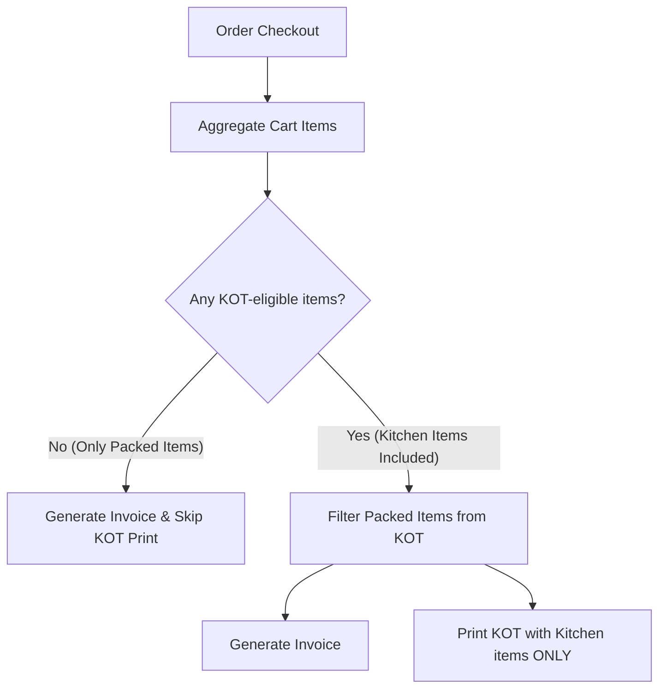
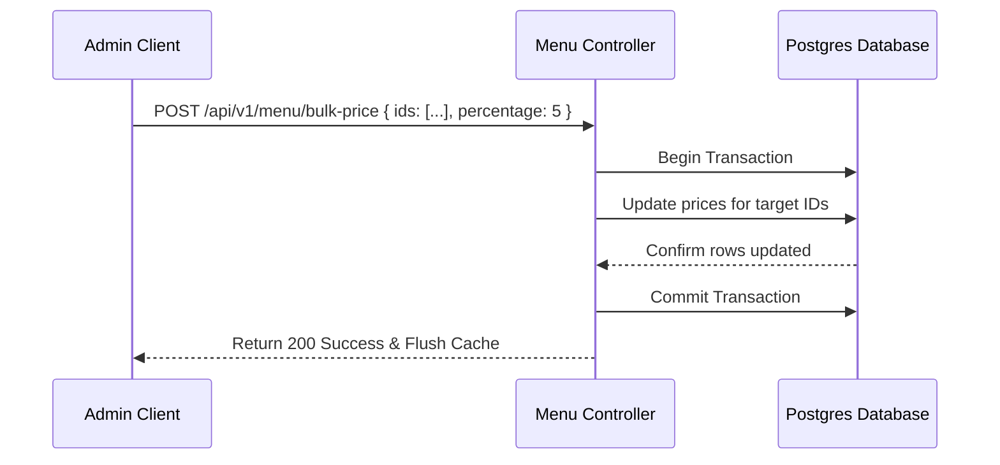
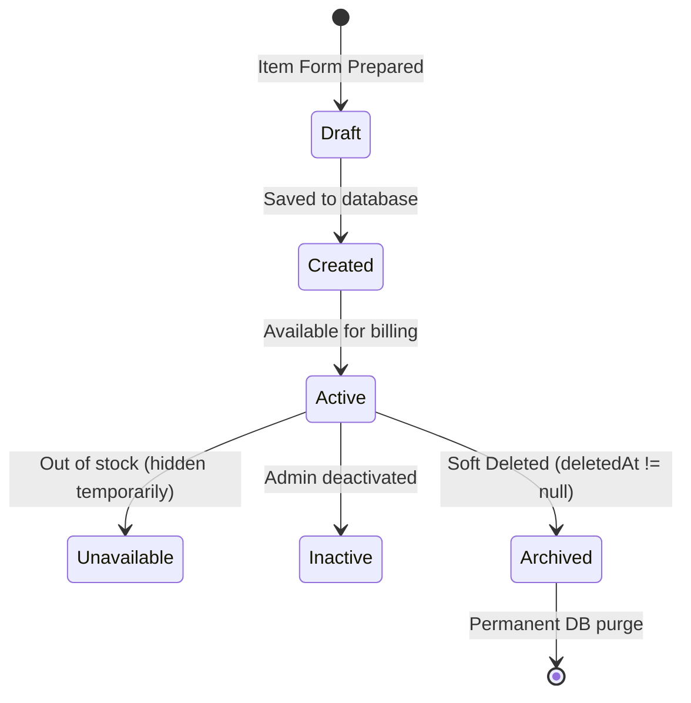

# Module 5 Design Document: Menu Management

This document specifies the enterprise architecture, database reviews, API specs, and interface layouts for the **Menu Management** module.

---

## 1. Module Overview
The Menu Management module controls the listing, availability, pricing, taxation, and classification of all items sold. Every order line, cashier receipt, kitchen ticket (KOT), and sales metric depends on these definitions.

---

## 2. Business Objectives
- **Operational Billing Accuracy**: Map prices and tax rates to prevent transaction discrepancy logs.
- **KOT Compliance**: Distinguish kitchen items (requires printing KOTs) from packed items (no KOT needed) automatically.
- **Fast Lookup**: Support short codes and barcode scans to minimize client queues.

---

## 3. Functional Requirements
- **Menu CRUD**: Full administrative controls to add, duplicate, restore, and soft-delete items.
- **Bulk Adjustments**: Batch adjust prices, categories, availability statuses, and tax rates.
- **Featured / Popular flags**: Highlight specific items on the cashier POS grids.

---

## 4. Non-Functional Requirements
- **Low Latency Searches**: Search indexing must resolve lookups in `<100ms`.
- **Local POS Cache**: Store menu lists locally after cashier login.
- **Responsive Drawer Forms**: Fast side-drawer forms for editing details on small terminal screen views.

---

## 5. User Stories
- *As an Admin, I want to bulk raise prices by 5% across our Beverages category so that I can offset seasonal pricing changes.*
- *As a Cashier, I want to scan a cold drink barcode to immediately add it to the cart without navigating folders.*

---

## 6. Use Cases
### Use Case: Add Masala Dosa (Kitchen Item)
1. Admin enters name, SKU, short code, price, and maps it to "South Indian" category.
2. Selects `KITCHEN` item type. Sets GST to 5%.
3. Saves item. System asserts unique SKU.
4. Item immediately becomes active and available.

---

## 7. Workflow
```mermaid
graph TD
    A[Prepaid Order Triggered] --> B{Check Item Type}
    B -- Kitchen Item --|Masala Dosa| --> C[Generate and Print KOT]
    B -- Packed Item --|Water Bottle| --> D[Add to Receipt: Skip KOT]
```

---

## 8. Business Rules
- **Category Required**: Every item must map to a valid, active category.
- **KOT Exclusions**: Packed items must never generate a KOT. If an order contains only packed items, no KOT is printed.
- **Active Only**: Items marked `Available = false` or `isActive = false` cannot be selected by checkout terminals.

---

## 9. Validation Rules
- **Price**: Greater than `0.00`.
- **GST Rate**: Minimum `0.00%`.
- **Short Code**: Max 6 character alphanumeric code (unique).

---

## 10. Database Review
The existing `MenuItem` model must be reviewed and upgraded to support detailed descriptors:

```prisma
model MenuItem {
  id              String       @id @default(uuid()) @db.Uuid
  categoryId      String       @db.Uuid
  name            String       @unique @db.VarChar(100)
  shortCode       String       @unique @db.VarChar(10)
  sku             String       @unique @db.VarChar(50)
  barcode         String?      @unique @db.VarChar(50)
  description     String?      @db.VarChar(255)
  price           Decimal      @db.Decimal(10, 2)
  gstPercentage   Decimal      @default(5.00) @db.Decimal(5, 2)
  itemType        ItemType     @default(KITCHEN) // KITCHEN, PACKED
  preparationTime Int          @default(10) // minutes
  displayOrder    Int          @default(0)
  image           String?      @db.VarChar(255)
  icon            String?      @db.VarChar(50)
  color           String?      @db.VarChar(7)
  isAvailable     Boolean      @default(true)
  isFeatured      Boolean      @default(false)
  isPopular       Boolean      @default(false)
  kitchenPriority String       @default("NORMAL") @db.VarChar(20) // LOW, NORMAL, HIGH
  createdBy       String?      @db.Uuid
  updatedBy       String?      @db.Uuid
  createdAt       DateTime     @default(now())
  updatedAt       DateTime     @updatedAt
  deletedAt       DateTime?
  category        Category     @relation(fields: [categoryId], references: [id], onDelete: Restrict)
  orderItems      OrderItem[]

  @@index([categoryId])
  @@index([shortCode])
  @@index([barcode])
  @@index([isAvailable])
  @@map("menu_items")
}
```

---

## 11. API Specifications

### GET `/api/v1/menu`
- *Access*: Authenticated users.
- *Query*: `category`, `search`, `availableOnly`.
- *Response*: Paginated array of MenuItems.

### POST `/api/v1/menu`
- *Access*: `SUPER_ADMIN` only.

### POST `/api/v1/menu/bulk-price`
- *Body*: `{ ids: string[], adjustPercentage: number, type: "INCREASE" | "DECREASE" }`

---

## 12. UI Wireframes (descriptive)
A premium SaaS UI:
- **Left Filter Bar**: Sticky Category sidebar filters and Search inputs (filters by short code, name, barcode).
- **Control Headers**: Bulk action controls (adjust prices, status toggle, move category, bulk delete).
- **Main Catalog Grid**: Grid of items showing thumbnail images, price badges, and colored category highlights.
- **Side Drawer**: Slide-out form containing input fields for quick edits.

---

## 13. Component List
- `CatalogGrid`: Displays cards.
- `ItemCard`: Individual item elements.
- `BulkActionBar`: Fixed footer when items are selected.
- `QuickEditDrawer`: Slide-in drawer editor.

---

## 14. Backend Services
- `MenuService`: Performs checks on SKUs, short codes, and categorizations. Handles bulk updates within DB transactions.

---

## 15. Folder Structure
- `backend/src/modules/menu/`
  - `controllers/menu.controller.ts`
  - `services/menu.service.ts`
  - `routes/menu.routes.ts`
- `frontend/src/pages/menu/`
  - `MenuCatalog.tsx`

---

## 16. Mermaid Workflow Diagram


---

## 17. Mermaid Sequence Diagram


---

## 18. Dependency Matrix
- **Category Module**: Menu Items require category mappings.
- **Billing/Orders**: Read prices and tax rates to execute sales.
- **Kitchen/KOT**: Read `itemType` to route prints.
- **Reports/Dashboard**: Read items and sales histories.

---

## 19. Performance Strategy
- **Zustand cache**: Loads all menu items on checkout dashboard launch.
- **Image CDN**: Optimize uploaded menu images to a maximum size of `150x150` pixels.
- **Loading Budget**: Load all items in `<300ms`, search resolves in `<100ms`.
- **Virtual Scrolling**: Enables smooth grids even with 1000+ items.

---

## 20. Search Strategy
- Check for exact matches on **Barcode** or **Short Code**. If found, bypass list views and add directly to cart.
- Perform fuzzy searches on Name if no exact match is returned.
- Filter by categories, tags, featured, and popular highlights.

---

## 21. Caching Strategy
- Settings stored inside Zustand cache (`pos-menu-storage`). Updated automatically when backend routes notify edits.
- Invalidated on CRUD events, trigger background updates.

---

## 22. Future Expansion Strategy
- **Modifiers & Add-ons**: Map optional groups (e.g. Extra Cheese) with local pricing overrides.
- **Branch overrides**: Scope price overrides inside a `MenuItemBranch` relation table.
- **Combo Deals**: Bundle items with fixed package pricing.

---

## 23. Acceptance Criteria
- [x] Create Menu Item: Must validate positive price, category reference, and unique SKU.
- [x] KOT check: Kitchen items trigger KOTs; packed items bypass KOT prints.
- [x] Bulk update: Can adjust prices by percentages inside database transactions.
- [x] Search: Shortcode/barcode quick add capability checks.

---

## 24. Testing Strategy
- **Unit tests**: Validate strong price constraints and barcode checks.
- **Integration tests**: Verify that orders containing packed items do not generate KOTs.
- **Search pings**: Validate search performance bounds.

---

## 25. Security Considerations
- Cashiers are restricted to GET requests (read-only menu catalog listings).
- Sanitize description fields to prevent XSS payloads.

---

## 26. Documentation Updates
- Add `docs/MENU_ARCHITECTURE.md` mapping KOT exclusions.
- Update `docs/DATABASE_DESIGN.md` with new `MenuItem` columns.

---

## 27. Menu Item Lifecycle


---

## 28. Menu Visibility Matrix
| Screen/View | Visibility | Description |
| :--- | :--- | :--- |
| **POS Billing** | Active & Available only | Cashier checkout catalogs |
| **Kitchen KOT** | Kitchen items only | Filters out beverages/water bottles |
| **Reports** | All Items | Historical reports including archived items |
| **Dashboard** | All Items | Sales analytics graphs |

---

## 29. Image Management
- **Format**: JPG, PNG, WebP only. Max 2MB.
- **Compression**: Automatically resize to `150x150` pixels for thumbnails, and `600x600` for detail cards.
- **Lazy Loading**: Native browser `loading="lazy"` checks.
- **Broken Link Handling**: Fallback to default product silhouette icons.

---

## 30. Standard Error Codes
- `MENU_001`: Duplicate Item Name.
- `MENU_002`: Item Not Found.
- `MENU_003`: Invalid Category.
- `MENU_004`: Invalid Price value.
- `MENU_005`: Inactive Item billing block.
- `MENU_006`: Cannot Delete item linked to orders.
- `MENU_007`: Duplicate Barcode value.
- `MENU_008`: Duplicate SKU.
- `MENU_009`: Image upload failure.
