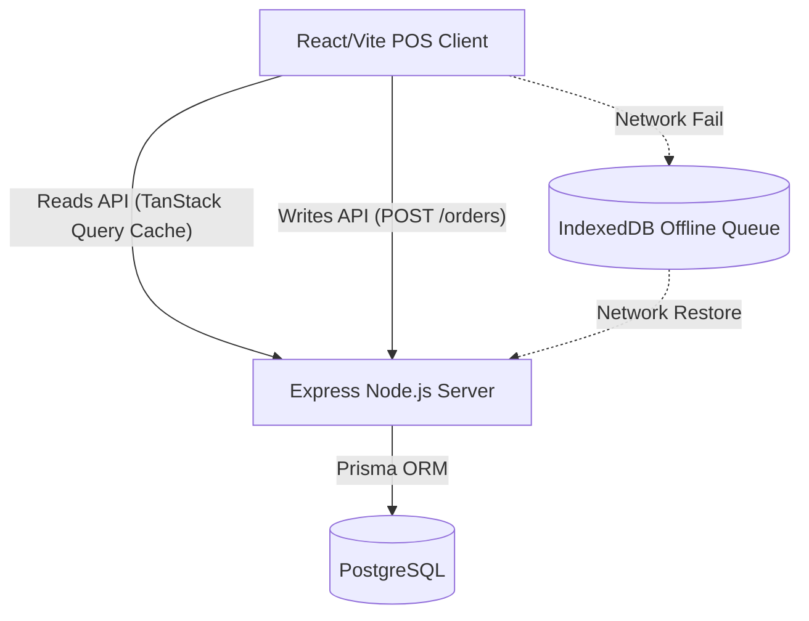

# System Architecture & Deployment Notes

## 1. High-Level Architecture Diagram

## 2. Infrastructure Requirements
- **Database**: PostgreSQL 14+
- **Backend Runtime**: Node.js 18+ LTS
- **Frontend Target**: Modern Chromium-based browser (Chrome, Edge, Brave) running on Windows/Android touchscreen terminals.

## 3. Database Architecture Note (Tokens)
Token generation is a known bottleneck and race-condition risk in POS systems. We use a dedicated `TokenCounter` table managed inside a Prisma `db.$transaction`. Because Prisma executes the transaction atomically, row-level locks prevent two terminals from retrieving the same token number on a busy Friday night.

## 4. Deployment Notes
### Environment Variables Required
**Backend (.env)**
- `DATABASE_URL` (Postgres connection string)
- `PORT` (defaults to 3000)
- `JWT_SECRET` (For auth middleware)

**Frontend (.env)**
- `VITE_API_URL` (defaults to `/api` proxy in dev, requires absolute URL in prod if hosted separately)

### Build Process
- Frontend: `npm run build` utilizes Vite and Rolldown to generate static files. Vendor chunks are explicitly split in `vite.config.ts`.
- Backend: `npm run build` runs `tsc` to emit JS files into the `dist` folder.

### Serving in Production
- Standard architecture: Nginx reverse proxy serving static frontend files on `/` and proxying `/api` requests to the Node.js process running via PM2 on port 3000.
