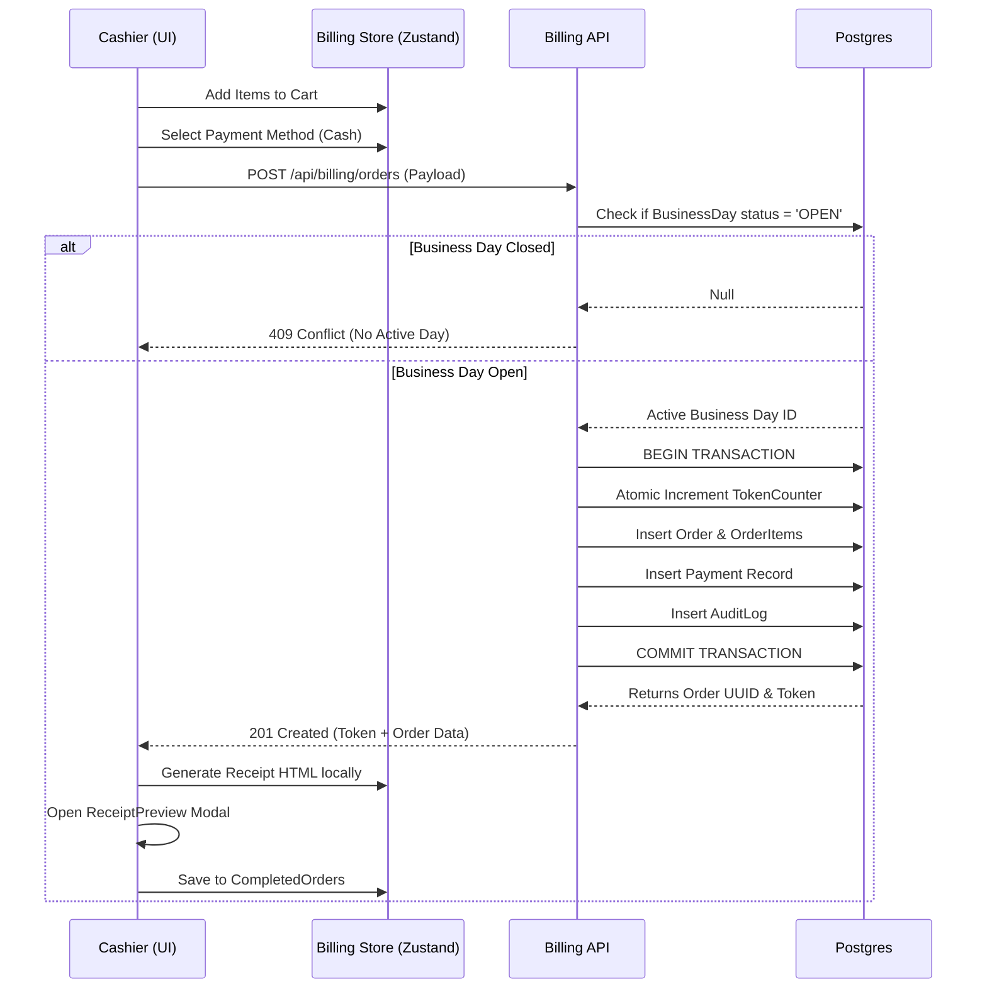
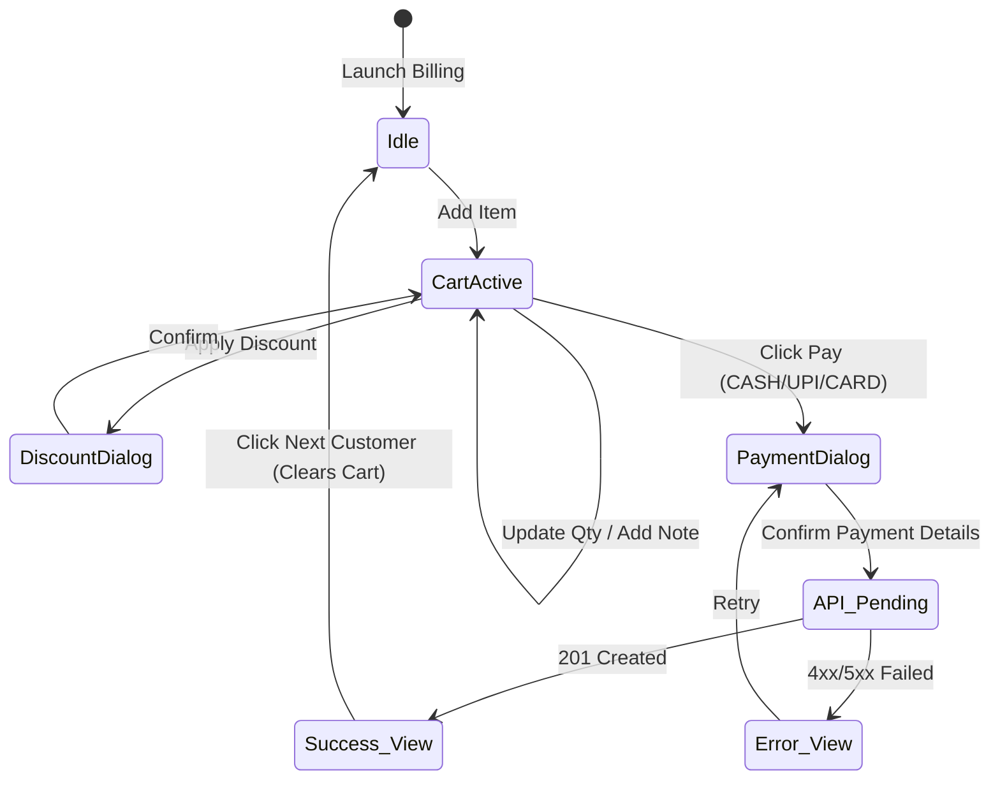

# Billing Workflow Documentation

This document visually describes the lifecycle of an order from selection to payment to KOT printing.

## 1. Sequence Diagram: Checkout Flow

## 2. State Diagram: UI Flow

## 3. Business Rules around KOTs
A critical requirement of this POS system is Zero-Waste Kitchen Routing. The workflow applies these rules automatically in the frontend when constructing the `ReceiptBundle`:
- **If Cart has NO Kitchen Items:** The `kot` field in the receipt bundle is strictly `null`. Only Customer and Restaurant receipts are shown.
- **If Cart has Mixed Items:** The `kot` template maps over the array and strictly filters out `itemType === 'PACKED'`. The cooks will not see Coca Cola on their slip.
