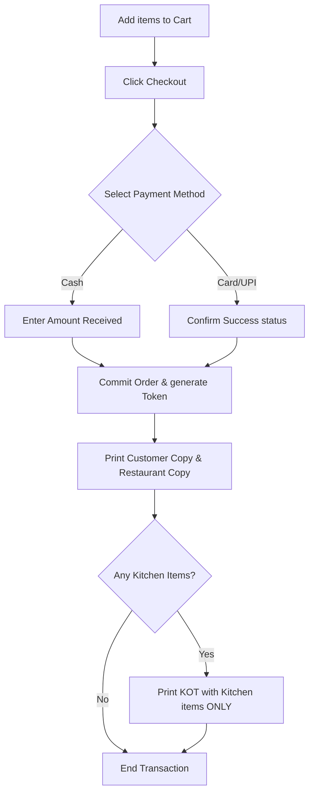
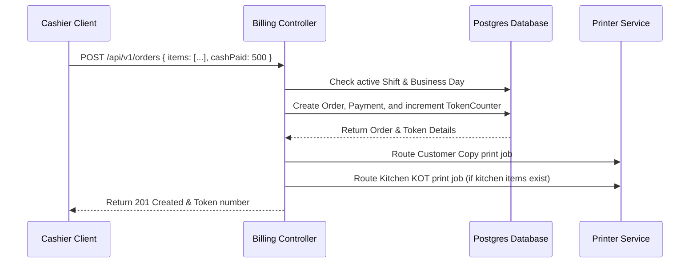
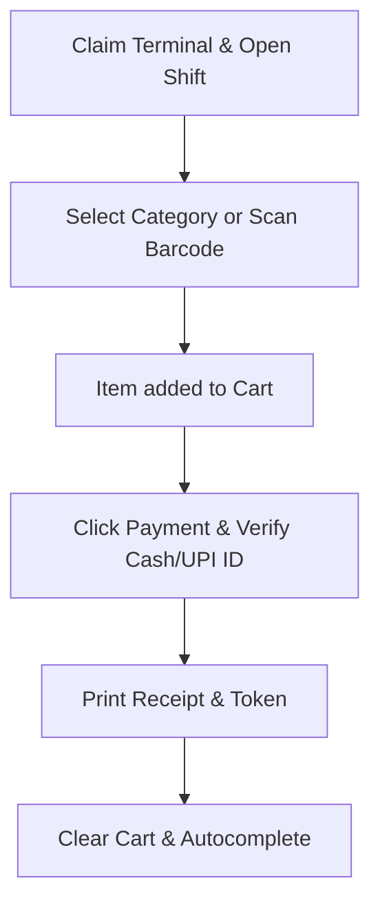
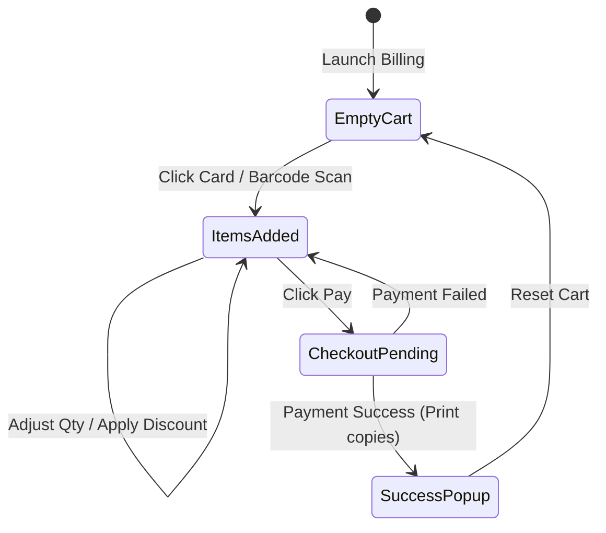
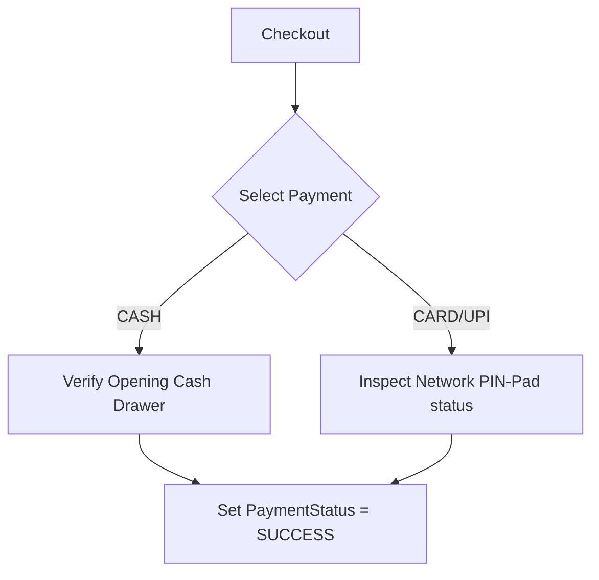
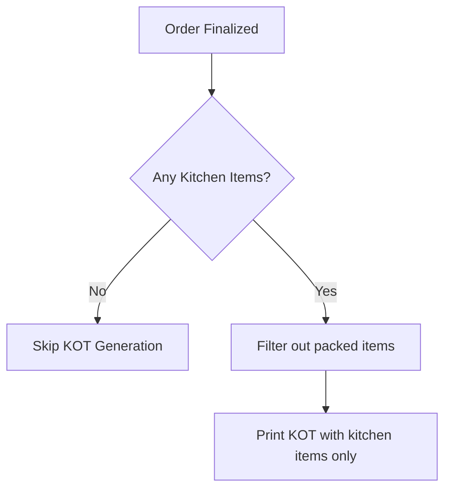
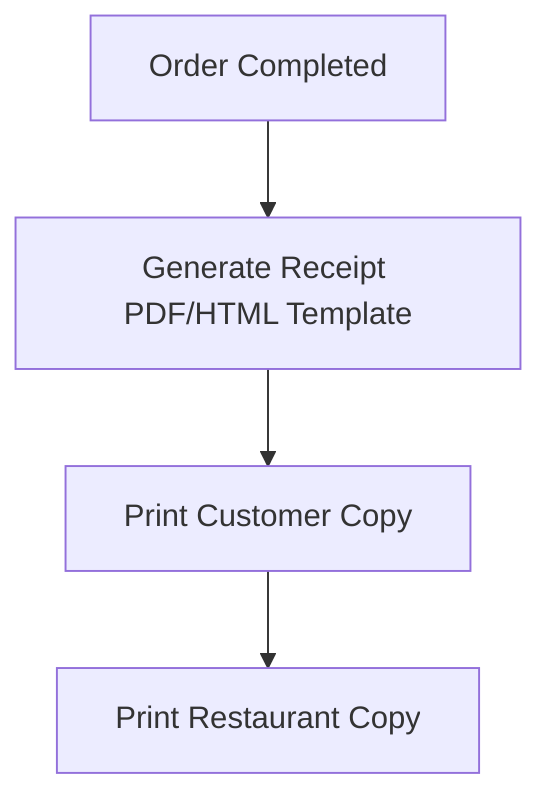

# Module 6 Design Document: POS Billing System

This document specifies the enterprise architecture, database integrations, API specs, Zustand store designs, and interface layouts for the **POS Billing System** module.

## 1. Module Overview
The POS Billing System is the cashier's checkout workspace. Built for speed, it runs completely prepaid billing transactions in under 30 seconds. It processes payments (Cash, Card, UPI), generates tokens, prints customer/restaurant receipts, and routes Kitchen Order Tickets (KOT) for kitchen items only.

> **Extensive Documentation Available:**
> - [API Documentation](file:///d:/restaurant_Pos/docs/MODULE6_BILLING/API_DOCS.md)
> - [Component Documentation](file:///d:/restaurant_Pos/docs/MODULE6_BILLING/COMPONENTS_DOCS.md)
> - [Store Documentation](file:///d:/restaurant_Pos/docs/MODULE6_BILLING/STORE_DOCS.md)
> - [Workflow & Diagrams](file:///d:/restaurant_Pos/docs/MODULE6_BILLING/WORKFLOW_DOCS.md)
> - [Architecture & Deployment](file:///d:/restaurant_Pos/docs/MODULE6_BILLING/ARCHITECTURE.md)
> - [Developer Guide & Checklist](file:///d:/restaurant_Pos/docs/MODULE6_BILLING/DEVELOPER_GUIDE.md)

---

## 2. Business Objectives
- **Sub-30 Second Checkouts**: Maximize throughput at high-volume counters.
- **Prepaid Immutable Audits**: Enforce "pay first, print KOT second" configurations.
- **Zero-Waste Kitchen Routing**: Filter packed items from KOT printing logs.

---

## 3. Functional Requirements
- **Category Navigation Sidebar**: Filter item catalogs by Category.
- **Dynamic Shopping Cart**: Interactive quantity triggers, manual overrides, discounts, and item notes.
- **Pre-Paid Checkout**: Process Cash, UPI, and Card checkouts immediately.

---

## 4. Non-Functional Requirements
- **Response Targets**: Billing screen load time `<500ms`, item search pings `<100ms`, checkout finalizations `<2s`.
- **Keyboard Mappings**: Support F1-F5 checkout triggers.

---

## 5. User Stories
- *As a Cashier, I want to click the UPI payment button, display a dynamic payment barcode, and scan the transaction ID in under 15 seconds.*
- *As a Kitchen Coordinator, I want KOT slips to omit packed soft drinks so that cooks focus only on kitchen dishes.*

---

## 6. Use Cases
### Use Case: Process Prepaid Mixed Order
1. Cashier scans barcode of "Water Bottle" (packed) and clicks "Plain Dosa" (kitchen).
2. Cart shows items. Cashier triggers "F3" (Cash Payment).
3. System confirms payment, increments Token, and prints Customer Receipt.
4. System prints KOT showing "Plain Dosa" ONLY. Water Bottle is omitted.

---

## 7. POS Workflow


---

## 8. Business Rules
- **Prepaid Billing Only**: Orders cannot be committed without a successful payment link.
- **Packed Exclusions**: Packed items never appear on KOT slips. If an order contains only packed items, no KOT is printed.
- **Immutable Orders**: Confirmed paid orders are locked. Only `SUPER_ADMIN` accounts can trigger cancellations.

---

## 9. Validation Rules
- **Cart Constraints**: Cannot checkout with empty carts.
- **Discounts**: Max manual discount restricted to 20% (requires admin role verification).

---

## 10. Database Review
Examines relations between `Order`, `OrderItems`, `Payments`, `TokenCounter`, and `BusinessDay`:

```prisma
// Verified that order fields map to terminalId and cashierShiftId.
// Payments tables successfully link method (CASH, UPI, CARD) to order IDs.
```

---

## 11. API Specifications

### POST `/api/v1/orders`
- *Access*: Authenticated cashiers.
- *Body*: `{ cashierShiftId, terminalId, items: [{ menuItemId, quantity, notes }], paymentMethod, amountPaid }`
- *Response*: `{ success: true, orderNumber, tokenNumber, customerReceiptHtml, kotReceiptHtml }`

### POST `/api/v1/orders/:id/reprint`
- *Access*: Authenticated cashiers.
- *Response*: Returns the existing receipt templates without incrementing token numbers.

---

## 12. UI Wireframes (Detailed)
- **Top Bar (5% height)**: Metadata displays (Terminal: Main Counter | Business Date: 2026-07-10 | Shift: Open) and global focused search input.
- **Left Panel (15% width)**: Vertical grid of touch buttons representing categories, color-coded.
- **Center Panel (50% width)**: Flow grid of menu item cards. Active items show prep times and featured badges.
- **Right Panel (35% width)**: Vertical shopping cart. Item counts, kitchen vs. packed indicators, subtotal calculations, GST breakouts, payment trigger drawers (Cash, Card, UPI), and "Confirm Receipt & Print" actions.

---

## 13. Component Breakdown
- `CategorySidebar`: Scrolling column of category items.
- `MenuGrid` & `MenuCard`: Grids of menu items.
- `Cart` & `CartItem`: Quantity inputs and swipe-to-delete actions.
- `OrderSummary`: Subtotals, round offs, and grand totals.
- `TokenPopup`: Modal displaying generated token numbers immediately upon checkout success.

---

## 14. Zustand Store Design (`billing.store.ts`)
```typescript
interface CartItem {
  id: string;
  name: string;
  price: number;
  quantity: number;
  itemType: 'KITCHEN' | 'PACKED';
}

interface BillingState {
  cart: CartItem[];
  selectedCategory: string | null;
  searchQuery: string;
  paymentMethod: 'CASH' | 'UPI' | 'CARD' | null;
  addToCart: (item: CartItem) => void;
  removeFromCart: (itemId: string) => void;
  updateQuantity: (itemId: string, qty: number) => void;
  clearCart: () => void;
}
```

---

## 15. Backend Services
- `OrderService`: Initiates order processing, payment status commits, and routes print queues within DB transactions.

---

## 16. Folder Structure
- `backend/src/modules/billing/`
  - `controllers/billing.controller.ts`
  - `services/billing.service.ts`
  - `routes/billing.routes.ts`
- `frontend/src/pages/billing/`
  - `POSWorkspace.tsx`

---

## 17. Sequence Diagram (Mermaid)


---

## 18. POS Workflow Diagram (Mermaid)


---

## 19. Billing State Diagram


---

## 20. Payment Flow Diagram


---

## 21. KOT Flow Diagram


---

## 22. Receipt Flow Diagram


---

## 23. Dependency Matrix
- **Category / Menu modules**: Items populate POS grids.
- **Terminal Management**: Workstation printer assignments.
- **Audit Logging**: Audits checkout events.

---

## 24. Performance Strategy
- **Zustand cache**: Loads all menu items on checkout dashboard launch.
- **Virtual Grids**: Render catalogs efficiently.
- **Targets**: Load <500ms, search <100ms, checkout <2 seconds, token <500ms, print <1 second.

---

## 25. Caching Strategy
- React Query cache: Automatically invalidates checkout caches when settings are modified.

---

## 26. Security Strategy
- Restricted access: Role checks ensure cashiers cannot cancel transactions or apply manual overrides above thresholds.
- Anti-double-click controls protect payment submission routes.

---

## 27. Cashier Productivity Metrics
- **Max Checkout**: `<30 seconds`.
- **Max Clicks**: `≤8`.
- **Max Touches**: `≤10`.

---

## 28. Smart Search & Cart Validations
- **Shortcodes & Barcodes**: Instantly add items to cart on exact matches.
- **Cart Validation Matrix**:
  - Checks if item is active, available, and not deleted.
  - Verifies current price matches database pricing record.
  - Assures active business day and open cashier shift gates.

---

## 29. POS Keyboard & Shortcut Panels
- `F1`: Search Focus.
- `F2`: Payment Menu.
- `F3`: Cash payment.
- `F4`: UPI payment.
- `F5`: Card payment.
- `F6`: Recent Orders Panel.
- `F7`: Reprint Copy.
- `Esc`: Cancel/Dismiss.
- `Ctrl+D`: Discount Input Dialog.
- `Ctrl+P`: Trigger Print.

---

## 30. Billing History Side-Panel
- Enables cashiers to view today's orders.
- Supports instant receipt reprinting.
- Supports cancellation requests (directs to admin passcode overlay).

---

## 31. Standardized Error Codes
- `BILLING_001`: Cart Empty.
- `BILLING_002`: Item Unavailable.
- `BILLING_003`: Payment failed.
- `BILLING_004`: Token generation failed.
- `BILLING_005`: Printer Offline.
- `BILLING_006`: Invalid Discount.
